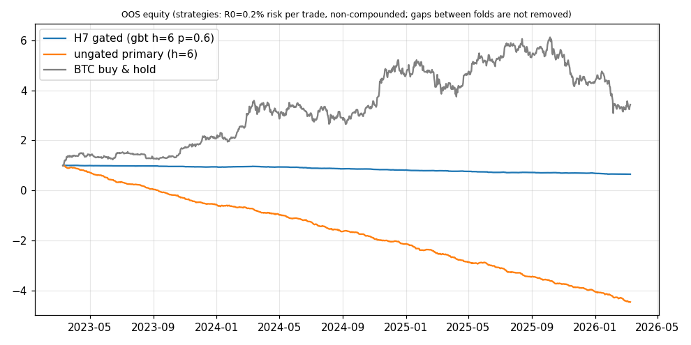

**H7 REJECTED** (candidate gbt h=6 p_min=0.6, portfolio, OOS only): (i) PASS; (ii) REJECTED; (iii) PASS; (iv) REJECTED; (v) REJECTED; (vi) PASS.

# H7 results (Amendment 3, walk-forward OOS only, holdout never loaded)

## Decisions fixed before the first run

```
D1  "realistic" cost preset = btclab.engine.costs.BINANCE_PERP_TAKER (0.05%/side + 2 bp slippage/side);
     "2x costs" doubles fee and slippage (funding is not doubled).
 D2  Class balance: TP-first is 10-27 % of events, so a literal p>0.52 gate would almost never fire. Both
     gates are trained with balanced class weights so that p=0.5 is the no-information point the sizing
     rule (p-0.5)/0.25 assumes. Logit C=1.0 (not in the grid, fixed). Precision = share of taken trades whose
     label is y=1 (TP first), as in the label definition; win rate (net PnL>0) is reported as information.
 D3  Model inputs = the builder's FEATURE_COLS + the 4 coin one-hots + event descriptors (direction, 4 trigger
     one-hots); direction/trigger are part of the event definition, without them the label is undefined.
     NaN -> 0 after standardisation for the logit (A1.4 "no signal"); HistGradientBoosting handles NaN natively.
 D4  Folds: walk_forward_folds on the BTC feature index (6 folds, 18m train / 6m test, end = holdout cutoff,
     embargo 24h, purge_bars=0).  Purge by label: a training event is kept only if bar_time >= train_start and
     end_h + 24h <= test_start - 24h (embargo).  Test events: bar_time in [test_start, test_end].
 D5  One open position per coin; events that arrive while a position in the same coin is open are skipped.
     Same-bar ties: gated -> highest p first, ungated -> trigger order taker, basis, oi, liq.  Ungated = all
     events, size 1, same h, same rules.
 D6  Sizing: notional = size * R0 / (ATR/entry), R0 = 0.2 % of equity risked per size-1 trade at the 1-ATR stop
     (equity base fixed at 1, non-compounded); if summed gross notional of open trades exceeds 1, every trade
     in that hour is scaled down proportionally (computed per trade at its worst hour).
 D7  Costs per trade = notional * 2 * (fee + slippage); funding = direction * notional * sum of 8h prints
     settled in (entry, exit].  Trade PnL is booked at the exit hour; Sharpe from daily sums (UTC), 365/yr.
 D8  (i) gated portfolio fold Sharpe > ungated (same h) in >= 4/6 folds; (iii) GBT beats logit in >= 7 of the
     12 matched (h, p) pairs; if (iii) fails the logistic gate is the candidate; (iv) >= 20 label shuffles of the
     training set, mean placebo Sharpe gain >= 80 % of the real gain (real gain <= 0 also fails);
     (vi) permutation importance = mean OOS AUC drop of a jointly permuted family block (5 repeats, per fold),
     share among the 5 signal families (context block reported separately); fails if max share > 60 %.
 D9  Candidate = best pooled OOS Sharpe of the 24 configs (selection is paid for in DSR N).
```

Not specified by the amendment and resolved above: the 'realistic' preset does not exist by that name in `btclab/engine/costs.py`, `BINANCE_PERP_TAKER` (the project default) was used. Folds: alt coins start 2022-01-01, so fold 0 trains on fewer alt events than BTC.

## Falsification tests (candidate, portfolio)

| test | verdict | evidence |
|---|---|---|
| (i) OOS Sharpe beats ungated in >= 4/6 folds | **PASS** | 6/6 folds |
| (ii) OOS precision of taken trades > 53% | **REJECTED** | 33.5% on 1592 trades |
| (iii) GBT beats logit OOS | **PASS** | GBT better in 11/12 matched (h,p) pairs |
| (iv) shuffled-label placebo gain < 80% of real gain | **REJECTED** | real gain +5.65, placebo mean gain +7.50 (20 shuffles) |
| (v) Sharpe at 2x costs > 0 | **REJECTED** | -5.55 |
| (vi) no family > 60% of permutation importance | **PASS** | max session 56% |

Best of the 24 configs by pooled OOS Sharpe: gbt h=6 p_min=0.6 (Sharpe -3.41). Candidate after (iii): gbt h=6 p_min=0.6.

Candidate OOS: Sharpe -3.41 vs ungated (h=6) -9.06; precision 33.5%; win rate 39.7%; trades 1592 (ungated 16072); maxDD 0.353 equity units (ungated 5.474).

## Statistical adjustment

- DSR, family only (N=24, variance of the 24 trial Sharpes): DSR=0.000, PSR(0)=0.000, annualised SR -3.41, passed(>0.95)=False.
- DSR, N=190884 (whole trials table incl. these 24), trial-Sharpe variance 1/T (null, as gauntlet.py): DSR=0.000, passed=False. With the empirical variance of the 24 H7 Sharpes: DSR=0.000.
- PBO (CSCV, 16 blocks, 24 configs, 12870 splits): **0.000** (gate < 0.15 / 0.20); mean OOS Sharpe of IS-best -0.198, P(loss) 1.00.

## All 24 configurations (portfolio, OOS pooled, 1x costs unless stated)

| gate | h | p_min | trades | Sharpe | ungated Sharpe (h) | folds > ungated | folds Sharpe>0 | precision | win rate | Sharpe 2x costs | maxDD | OOS net return |
|---|---|---|---|---|---|---|---|---|---|---|---|---|
| logit | 2 | 0.52 | 8261 | -7.35 | -12.50 | 6/6 | 0/6 | 15.1% | 40.9% | -11.24 | 1.355 | -1.354 |
| logit | 2 | 0.55 | 6327 | -6.92 | -12.50 | 6/6 | 0/6 | 16.2% | 40.8% | -10.64 | 1.254 | -1.252 |
| logit | 2 | 0.58 | 4664 | -6.39 | -12.50 | 6/6 | 0/6 | 16.9% | 40.4% | -9.76 | 1.119 | -1.117 |
| logit | 2 | 0.6 | 3716 | -5.99 | -12.50 | 6/6 | 0/6 | 17.4% | 40.1% | -9.10 | 1.001 | -1.000 |
| gbt | 2 | 0.52 | 5875 | -6.67 | -12.50 | 6/6 | 0/6 | 16.9% | 40.7% | -10.22 | 1.003 | -1.002 |
| gbt | 2 | 0.55 | 4401 | -6.37 | -12.50 | 6/6 | 0/6 | 17.8% | 40.3% | -9.75 | 0.941 | -0.939 |
| gbt | 2 | 0.58 | 3214 | -5.81 | -12.50 | 6/6 | 0/6 | 18.8% | 40.1% | -8.94 | 0.817 | -0.816 |
| gbt | 2 | 0.6 | 2560 | -5.51 | -12.50 | 6/6 | 0/6 | 19.4% | 39.6% | -8.42 | 0.736 | -0.735 |
| logit | 4 | 0.52 | 8004 | -7.02 | -10.23 | 6/6 | 0/6 | 24.4% | 40.2% | -10.77 | 1.073 | -1.071 |
| logit | 4 | 0.55 | 5704 | -6.52 | -10.23 | 6/6 | 0/6 | 25.3% | 39.7% | -9.92 | 0.981 | -0.980 |
| logit | 4 | 0.58 | 3507 | -5.82 | -10.23 | 6/6 | 0/6 | 25.9% | 38.8% | -8.72 | 0.779 | -0.778 |
| logit | 4 | 0.6 | 2342 | -4.79 | -10.23 | 6/6 | 0/6 | 27.1% | 39.1% | -7.42 | 0.569 | -0.568 |
| gbt | 4 | 0.52 | 6507 | -6.31 | -10.23 | 6/6 | 0/6 | 26.2% | 39.9% | -9.77 | 0.908 | -0.905 |
| gbt | 4 | 0.55 | 4504 | -5.74 | -10.23 | 6/6 | 0/6 | 27.1% | 39.4% | -8.95 | 0.800 | -0.798 |
| gbt | 4 | 0.58 | 2827 | -4.70 | -10.23 | 6/6 | 0/6 | 28.5% | 39.8% | -7.58 | 0.595 | -0.589 |
| gbt | 4 | 0.6 | 1909 | -3.92 | -10.23 | 6/6 | 0/6 | 29.8% | 40.4% | -6.51 | 0.442 | -0.435 |
| logit | 6 | 0.52 | 7634 | -6.04 | -9.06 | 6/6 | 0/6 | 30.4% | 40.1% | -9.62 | 0.822 | -0.822 |
| logit | 6 | 0.55 | 5006 | -5.24 | -9.06 | 6/6 | 0/6 | 31.3% | 39.8% | -8.43 | 0.694 | -0.694 |
| logit | 6 | 0.58 | 2710 | -4.32 | -9.06 | 6/6 | 0/6 | 32.6% | 39.6% | -6.96 | 0.480 | -0.480 |
| logit | 6 | 0.6 | 1611 | -3.59 | -9.06 | 6/6 | 0/6 | 32.7% | 39.5% | -5.80 | 0.339 | -0.339 |
| gbt | 6 | 0.52 | 6685 | -5.97 | -9.06 | 6/6 | 0/6 | 30.9% | 39.4% | -9.29 | 0.809 | -0.809 |
| gbt | 6 | 0.55 | 4404 | -5.20 | -9.06 | 6/6 | 0/6 | 32.0% | 40.0% | -8.22 | 0.676 | -0.677 |
| gbt | 6 | 0.58 | 2491 | -4.46 | -9.06 | 6/6 | 0/6 | 32.0% | 38.7% | -6.87 | 0.527 | -0.528 |
| gbt | 6 | 0.6 | 1592 | -3.41 | -9.06 | 6/6 | 0/6 | 33.5% | 39.7% | -5.55 | 0.353 | -0.352 |

## GBT vs logit matched pairs (OOS Sharpe)

| h | p_min | logit | GBT |
|---|---|---|---|
| 2 | 0.52 | -7.35 | -6.67 |
| 2 | 0.55 | -6.92 | -6.37 |
| 2 | 0.58 | -6.39 | -5.81 |
| 2 | 0.6 | -5.99 | -5.51 |
| 4 | 0.52 | -7.02 | -6.31 |
| 4 | 0.55 | -6.52 | -5.74 |
| 4 | 0.58 | -5.82 | -4.70 |
| 4 | 0.6 | -4.79 | -3.92 |
| 6 | 0.52 | -6.04 | -5.97 |
| 6 | 0.55 | -5.24 | -5.20 |
| 6 | 0.58 | -4.32 | -4.46 |
| 6 | 0.6 | -3.59 | -3.41 |

## Per-fold OOS Sharpe (candidate vs ungated)

| fold | test window | gated | ungated |
|---|---|---|---|
| 0 | 2023-03-10 .. 2023-09-10 | -2.64 | -11.42 |
| 1 | 2023-09-10 .. 2024-03-10 | -1.32 | -7.66 |
| 2 | 2024-03-10 .. 2024-09-10 | -4.42 | -8.26 |
| 3 | 2024-09-10 .. 2025-03-10 | -5.00 | -9.06 |
| 4 | 2025-03-10 .. 2025-09-10 | -3.47 | -8.75 |
| 5 | 2025-09-10 .. 2026-03-10 | -3.59 | -9.46 |

## Per coin (candidate vs ungated, OOS, equity base 1 shared across coins)

| coin | gated Sharpe | gated net ret | gated trades | gated precision | ungated Sharpe | ungated net ret | ungated trades | ungated precision |
|---|---|---|---|---|---|---|---|---|
| BTC | -2.06 | -0.090 | 290 | 35.2% | -7.53 | -1.914 | 3667 | 25.9% |
| ETH | -1.10 | -0.050 | 403 | 37.0% | -5.08 | -1.262 | 3963 | 27.8% |
| SOL | -1.58 | -0.080 | 499 | 33.1% | -4.52 | -1.147 | 4474 | 27.3% |
| XRP | -2.54 | -0.132 | 400 | 29.5% | -4.70 | -1.139 | 3968 | 27.8% |

## Placebo gates (shuffled training labels)

| config | real gain | placebo mean gain | share of shuffles >= 80% of real gain | verdict |
|---|---|---|---|---|
| gbt h=6 p=0.6 | +5.65 | +7.50 | 100% | REJECTED |
| logit h=6 p=0.6 | +5.47 | +8.72 | 100% | REJECTED |

## Permutation importance (mean OOS AUC drop per family block)

| gate h | order_flow | liquidation_map | positioning | basis | session | _context | max signal-family share |
|---|---|---|---|---|---|---|---|
| logit h=6 | +0.0020 | +0.0154 | +0.0075 | +0.0010 | +0.0267 | +0.0182 | 51% |
| gbt h=6 | +0.0018 | +0.0038 | +0.0124 | +0.0022 | +0.0258 | +0.0213 | 56% |

## Equity, OOS only

| series | Sharpe | OOS return | ann. vol | maxDD (equity units) |
|---|---|---|---|---|
| H7 gated (candidate) | -3.41 | -35.2% | 3.4% | 0.353 |
| Ungated primary | -9.06 | -546.2% | 20.1% | 5.474 |
| BTC buy & hold | 1.10 | +243.4% | 47.7% | 3.035 |


